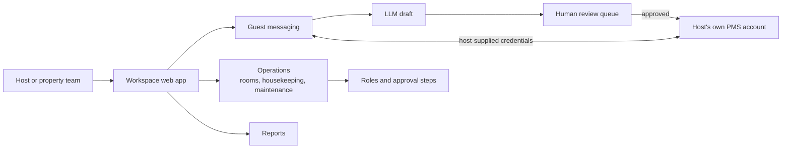

# CoHostBnB: case study

**An operations workspace for short-term rentals and small lodging.** Guest replies, room preparation and maintenance in one place, with AI drafts that a person approves before anything reaches a guest.

Designed and built by [Iskra Astudillo](https://github.com/iskra-astudillo) at Elite AI Holdings, drawing on years of running short-term rental and property-management operations. AI coding agents did most of the implementation under review. Source is private; this repo documents the design.

## Problem

Small hosts and property managers run guest messages in one tool, cleaning in a group chat and maintenance in a notebook. Fully automated AI replies are risky: one wrong answer about check-in or a refund lands on a guest mid-stay. Hotels, hostels and B&Bs also need room- and bed-level records that listing-centric tools do not model.

## What it does

- Models single listings, multi-unit buildings, hotels, motels, hostels and B&Bs, down to rooms and dorm beds.
- Drafts guest replies with an LLM, for a person to review and send.
- Tracks room status (dirty, clean, inspected, out of order), housekeeping assignments and maintenance requests against the property.
- Connects to the host's own property-management system for guest messaging. The host brings the credentials.
- Team roles and approval steps, so follow-up is accountable across cleaners, managers and owners.

## Architecture

## Engineering decisions

| Decision | Why |
|---|---|
| **Draft, then approve.** The model proposes; a person sends. | A guest never gets an unreviewed message by default. Speed comes from the draft, safety from the review. |
| **Bring your own credentials.** Integrations use the host's own PMS and messaging accounts. | Data ownership and blast radius stay with the host. We are software, not a shared account reseller. |
| **Not a channel manager.** The PMS stays responsible for availability across listing sites. | Double-booking logic is a hard problem someone else already owns. CoHostBnB keeps the operational record. |
| **Rooms and beds are first-class.** | A hostel bed and a whole-home listing need the same housekeeping and maintenance workflow at different granularity. |
| **One engine behind more than one audience.** | Hosts, managers and small hotels share the same core, so a fix ships once. |

## Stack

Web app and API in Docker on self-hosted infrastructure, LLM drafting behind a provider-agnostic router, integrations through each host's own provider accounts. Built with Claude Code and Codex as the coding agents; I own the architecture, the review and the release decision.

## Status

- Live: https://cohostbnb.xyz (free signup)
- Source: private

## License

Documentation: CC BY 4.0. See [LICENSE](LICENSE).
